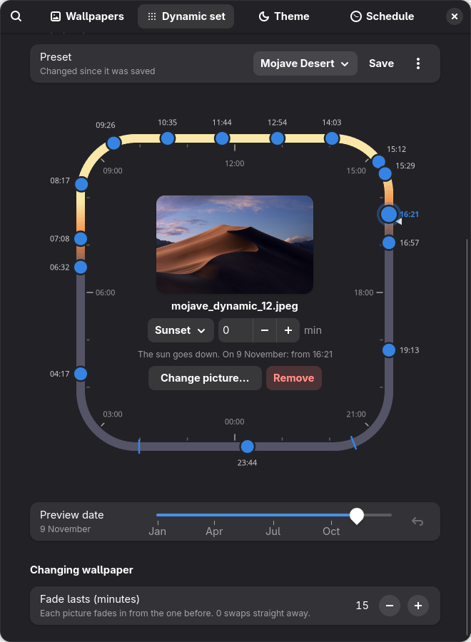
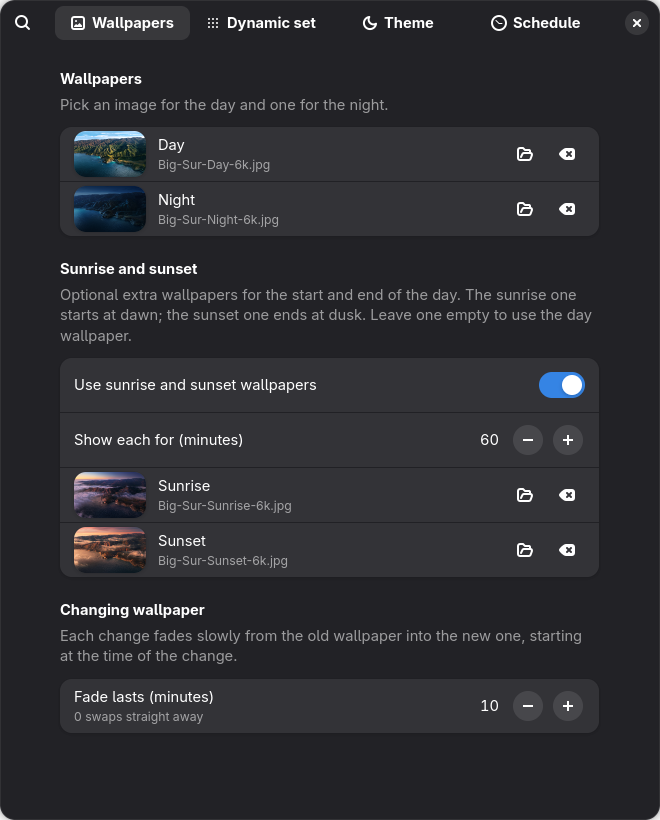
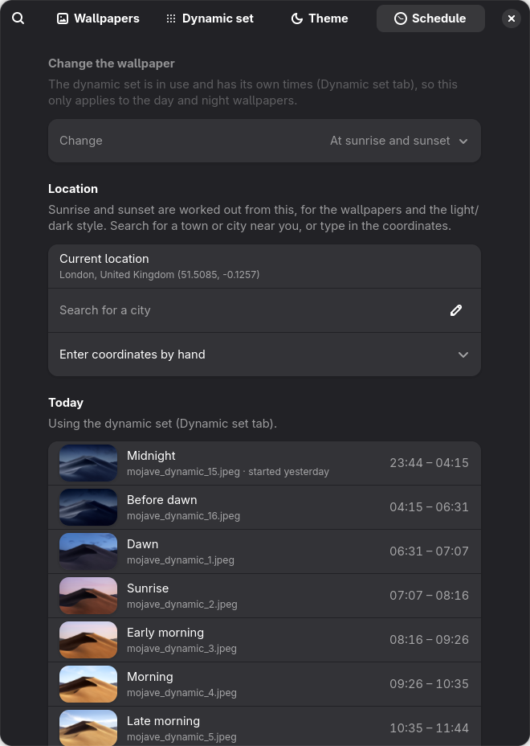
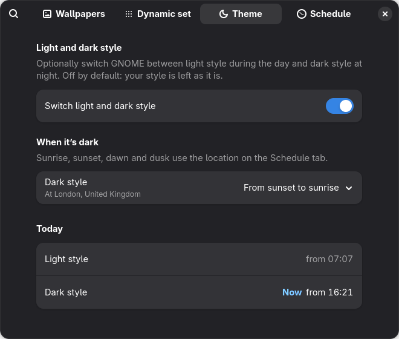

# Dynamic Wallpaper

Complete transparency: This was made with the help of Claude
A GNOME Shell extension that changes your wallpaper through the day:

- **Day and night wallpapers**, switched at **sunrise and sunset** for your
  location, or at **times you choose**.
- Optional **sunrise and sunset wallpapers**, starting at dawn and ending
  at dusk (an hour each by default).
- **Slow fades** between wallpapers, as long as you like (15 minutes by
  default). The right wallpaper shows from the moment you log in.
- Find your location by **searching for a city** (works offline, using the
  same list as GNOME Weather), or type in the coordinates.
- A **Dynamic set** tab for any number of pictures (8, 16, 24…) placed
  around a 24-hour clock, by time of day or by the sun's position (so they
  follow the seasons). See [docs/5](docs/5-dynamic-set.md).
- Optionally **switch between light and dark style** (its own Theme tab,
  off by default): dark from sunset to sunrise, from dusk to dawn, or at
  set times.

<p align="center">
  
</p>

| Wallpapers | Schedule | Theme |
| --- | --- | --- |
|  |  |  |

Made for GNOME 49–51 (developed on Fedora 45 with GNOME 51).

**Where it's up to, and what's next:** see [STATUS.md](STATUS.md).

## Project layout

```text
src/                     the extension itself (this folder is what gets installed)
  metadata.json          name, ID, supported GNOME versions
  extension.js           runs inside GNOME Shell and changes the wallpaper
  prefs.js               the settings window
  dynamicSetPage.js      the settings window's Dynamic set tab (the clock)
  lib/sun.js             sunrise and sunset maths
  lib/schedule.js        decides which wallpaper should show, and when
  lib/slideshow.js       writes that as a slideshow GNOME times by itself
  lib/dynamicSet.js      scheduling for the dynamic set (many pictures)
  schemas/*.gschema.xml  the settings the extension stores
tests/                   tests and a settings-window preview tool
docs/                    guides to how GNOME extensions work (start here)
Makefile                 shortcuts for everything below
```

## Quick start

```bash
make test       # run the tests
make prefs      # open the settings window straight from src/
make link       # install for development, then log out and back in
gnome-extensions enable dynamic-wallpaper@eusebiuxii.com
```

Run `make help` for the full list.

## Guides

New to GNOME extensions? Read these in order:

1. [What a GNOME extension is](docs/1-what-is-a-gnome-extension.md):
   the pieces, and how GNOME loads them.
2. [How this extension works](docs/2-how-this-extension-works.md):
   a tour of the code.
3. [Developing and testing](docs/3-developing-and-testing.md):
   running it, seeing errors, testing changes without logging out.
4. [Building and releasing](docs/4-building-and-releasing.md):
   packing a zip, publishing on extensions.gnome.org, and updates.
5. [The dynamic set](docs/5-dynamic-set.md): the Dynamic set tab, what it
   does and how it works.

## Licence

GPL-2.0-or-later, the same as GNOME Shell. See [LICENSE](LICENSE).
